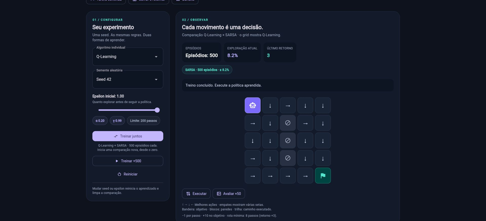
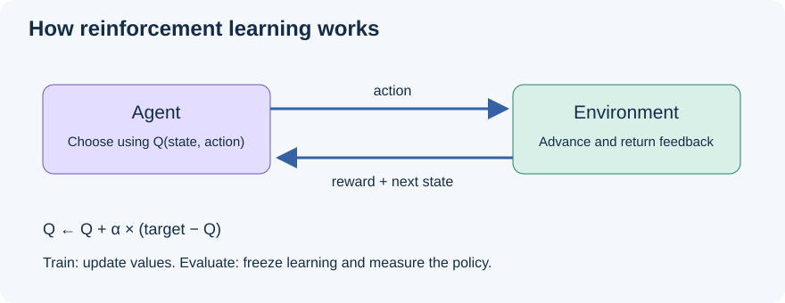
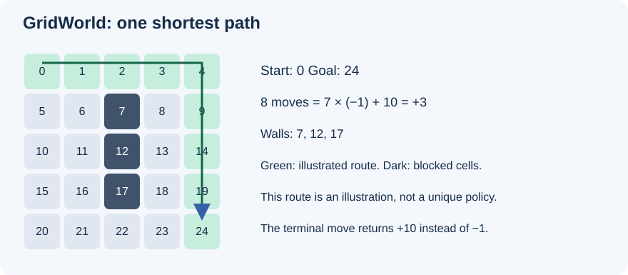
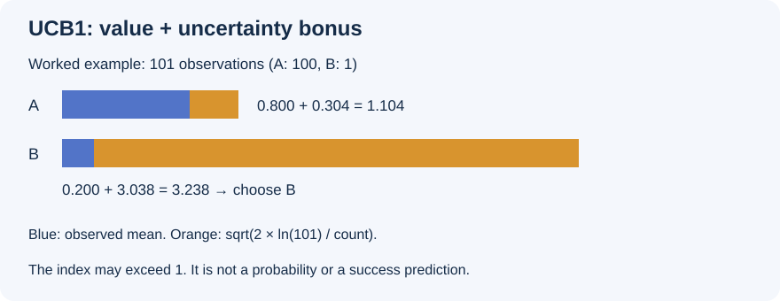

# reinforcement_engine

[](https://github.com/kleberandrade/reinforcement-engine/actions/workflows/ci.yml)
[](https://pub.dev/packages/reinforcement_engine)
[](LICENSE)

Learn decisions from rewards with **pure Dart**, typed contracts and no runtime
dependencies. Includes Q-Learning, SARSA, Expected SARSA, Double Q, R-learning,
SARSA(λ), **Watkins Q(λ)** and **multi-armed bandits** (epsilon-greedy and UCB1).

[Português](README.pt-BR.md) · [Learning guide](doc/learning_guide.md) ·
[Flutter lab](example/flutter_lab/README.md) · [Architecture](doc/architecture.md)

**[Open the live laboratory](https://kleberandrade.github.io/reinforcement-engine/)**

Interactive gridworld: policy arrows, full reward history with moving averages,
one-click Q-Learning/SARSA training, a responsive dashboard and seeded epsilon exploration,
pause/resume and independent greedy evaluation. [Scenario guide](example/flutter_lab/README.md).



Source version: **0.5.0**. The badge links to the independently published pub.dev
version; a source commit does not imply publication. New 0.5 examples can be run
from this checkout. Dart **3.3+**; Flutter is needed only for the interactive lab.

## What does reinforcement learning do?

A maze agent starts without a route. It chooses a move, receives a reward and
adjusts its estimate of that move's future value. Over many episodes it can learn
a useful route. You supply the environment, actions and reward definition.



**Training** changes estimates and explores. **Evaluation** measures a fixed policy
on fresh episodes. A reward is feedback defined by your application; it is not a
label or a probability that the action is correct.

## Choose the right model

| Your problem | Starting point | Why |
| --- | --- | --- |
| Choose an option and observe its immediate reward | `BanditAgent` + `Ucb1` or `EpsilonGreedyBandit` | No next-state or delayed-return model |
| Learn a route or sequence of decisions | `TabularAgent` with Q-Learning | Learns discounted future action values |
| Learn the value of the behavior actually followed | SARSA or Expected SARSA | Sampled next action or behavior-weighted expectation |
| Reduce maximization bias using two estimators | `DoubleQAgent` | Selects with one table, evaluates with the other |
| Propagate feedback through recent visits | `SarsaLambdaAgent` or `WatkinsQLambdaAgent` | Accumulating eligibility traces |
| Optimize average reward in a continuing task | `RLearningAgent` | Relative values plus average-reward estimate |

These are tabular finite/discrete methods. Raw images, contextual bandits, DQN,
policy gradients and continuous-control algorithms are outside this release.

## Install and run

For the published package:

```sh
dart pub add reinforcement_engine
# In Flutter: flutter pub add reinforcement_engine
```

For this source version, use a local checkout in your application's `pubspec.yaml`:

```yaml
dependencies:
  reinforcement_engine:
    path: ../reinforcement_engine
```

Run the repository examples with `dart pub get` followed by
`dart run example/watkins.dart` or `dart run example/bandits.dart`.

## First example: learn a maze

```dart
import 'package:reinforcement_engine/reinforcement_engine.dart';

void main() {
  final maze = GridWorld();
  final agent = TabularAgent<int, GridAction>(
    learningRate: 0.1,
    discountFactor: 0.99,
    epsilon: 1,
    epsilonDecay: 0.995,
    minEpsilon: 0.01,
    seed: 42,
  );
  for (var episode = 0; episode < 500; episode++) {
    trainEpisode(environment: maze, agent: agent, maxSteps: 200);
  }
  final report = evaluatePolicy<int, GridAction>(
    environmentFactory: GridWorld.new,
    policy: GreedyPolicy(agent.values),
    isSuccess: (state, episode) => episode.terminated && state == maze.goal,
    episodes: 20,
    maxSteps: 100,
    seed: 7,
  );
  print('Success: ${report.successRate}; steps: ${report.meanSteps}');
}
```

`int` identifies a cell; `GridAction` identifies a move. `Q(state, action)` estimates
a discounted return, not a probability. Unseen pairs initially have value zero.
The default maze rewards each nonterminal move with −1 and the goal move with +10.



An eight-move successful episode returns **+3**: seven ordinary moves and one
terminal move. Other shortest paths exist. The illustration is a valid route,
not a promise that every seed learns it. See [evaluation](doc/evaluation.md) for
success rates, rewards, step limits and preservation of learner state.

## Understand one update

For Q-Learning, the nonterminal target is `reward + gamma × max Q(nextState, a)`.
Every update moves partway from the current estimate toward that target:

```text
current Q = 2     reward = 1     best next Q = 4
alpha = 0.25     gamma = 0.8
new Q = 2 + 0.25 × (1 + 0.8 × 4 − 2) = 2.55
```

| Parameter | Meaning | Typical caution |
| --- | --- | --- |
| `learningRate` / α | Weight of the new TD error | Large values can make learning unstable |
| `discountFactor` / γ | Weight of future value | Task-dependent; not used by R-learning |
| `epsilon` / ε | Epsilon-greedy exploration probability | `epsilon: 0` also needs `minEpsilon: 0` |
| `lambda` / λ | Eligibility retention together with γ | More active traces increase per-step work |
| `averageRewardRate` / β | R-learning estimate update rate | Separate from the Q-value step size |

**Termination** ends the task and uses zero bootstrap. **Truncation** ends an
external budget, retains bootstrap, and requires legal actions in the returned
state. R-learning uses its own continuing-task contract and rejects such boundaries.

## Watkins Q(λ): Q-Learning with a memory of recent visits

```dart
final agent = WatkinsQLambdaAgent<int, GridAction>(lambda: 0.8, seed: 42);
for (var episode = 0; episode < 500; episode++) {
  trainEpisodic(environment: GridWorld(), agent: agent, maxSteps: 200);
}
```

The target uses the best legal next value. Recent pairs receive the same TD error
weighted by their traces. If the next sampled action is nongreedy, traces are
cleared **after the current update**. All tied maxima count as greedy, determined
before changing Q-values. `trainEpisodic` guarantees cleanup at episode boundaries
and on exceptions. Manual loops must carry the actual sampled next action.

With λ = 0, the update reduces to one-step Q-Learning; identical seeded trajectories
are not promised because Watkins samples its next action before the update.
See the [worked trace example](doc/watkins.md) and run `dart run example/watkins.dart`.

## Bandits: learn which option pays off now

```dart
import 'package:reinforcement_engine/reinforcement_engine.dart';

void main() {
  final agent = BanditAgent<String>(
    arms: ['A', 'B', 'C'], policy: const Ucb1<String>(), seed: 42,
  );
  for (var i = 0; i < 3000; i++) {
    final arm = agent.selectArm();
    // Synthetic deterministic rewards; your application supplies real feedback.
    final reward = {'A': 0.2, 'B': 0.5, 'C': 0.8}[arm]!;
    agent.observe(arm, reward);
  }
  print(agent.values.mean('C'));
  print(agent.values.count('C'));
}
```

Each arm is one option. Rewards must be finite and normalized to **[0, 1]**.
`EpsilonGreedyBandit` explores with a fixed ε and otherwise chooses a maximum
sample mean. `Ucb1` first samples unseen arms, then balances observed means and an
uncertainty bonus. Both break ties uniformly using the agent RNG.



The UCB index is **not a probability** and may exceed 1. Its analysis assumes
stationary, independent bounded rewards. Adaptive selection alone does not prove
causal effects or handle changing user context. Run the stochastic simulation
`dart run example/bandits.dart`; see [bandits](doc/bandits.md) for normalization,
feedback ownership, sample means and bounded training.

## Save learning and build your own environment

`TrainingCheckpoint` stores supported built-in agents' tables, configuration and
current exploration, plus the R-learning reward estimate. Double Q keeps both
tables. SARSA(λ)/Watkins Q(λ) must be captured at a true episode boundary without
active traces. Restoration starts a **new RNG stream**. Bandit checkpoints are not
part of this format. [Checkpoint guide](doc/checkpoints.md).

Implement `Environment<S, A>` for sequential tasks, `TdUpdateRule` for custom
one-step targets, or `BanditPolicy` for immediate-reward selection. Prefer immutable
keys with stable equality/hash codes. Keep IO, reward collection and Flutter
scheduling in the application. [Extension guide](doc/extending.md).

## Learn by doing

| Goal | Runnable example | Guide |
| --- | --- | --- |
| Understand terms, rewards and the training cycle | [Maze](example/reinforcement_engine_example.dart) | [Learning guide](doc/learning_guide.md) |
| Compare control targets and exploration | [Exploration](example/exploration.dart) | [Control](doc/control.md) |
| Use Watkins traces and observe trace cutting | [Watkins](example/watkins.dart) | [Watkins Q(λ)](doc/watkins.md) |
| Select immediate-reward options | [Bandits](example/bandits.dart) | [Bandits](doc/bandits.md) |
| Evaluate without training | [Evaluation](example/evaluation.dart) | [Evaluation](doc/evaluation.md) |
| Continue without terminal states | [Maintenance](example/continuing.dart) | [R-learning](doc/continuing.md) |
| Save and resume learning | [Checkpoint](example/checkpoint.dart) | [Checkpoints](doc/checkpoints.md) |
| Extend contracts | [Custom environment/rule](example/custom_extensions.dart) | [Extending](doc/extending.md) |

## Interactive Flutter lab

```sh
cd example/flutter_lab
flutter pub get
flutter run -d chrome
```

Choose six maze algorithms, animate the learned route, evaluate it, open the
continuing maintenance task, transfer a checkpoint or watch bandit selection bars.
The bars show **selection shares**, not success probabilities. Training runs in
bounded batches between frames. The core remains synchronous and Flutter-free.

## Validation and limits

```sh
dart pub get
dart format --output=none --set-exit-if-changed lib test example benchmark validation tool
dart analyze --fatal-infos
dart test
dart run example/watkins.dart
dart run example/bandits.dart
```

See [CONTRIBUTING](CONTRIBUTING.md) for the full checks, including Flutter and the
independent public-contract consumer. Seeded runs depend on runtime, action order
and environment RNGs. No cross-runtime bitwise guarantee is made. Educational
examples do not establish general convergence, safety or production performance.
The [420-run stability report](doc/benchmarks/stability.md) concerns the earlier
SARSA(λ)/R-learning implementation, not a benchmark of the new algorithms.

[Source map](doc/architecture/structure.md) · [Class diagrams](doc/architecture/class_diagrams.md) ·
[Migration](doc/migration.md) · [Roadmap](doc/roadmap.md) · [Changelog](CHANGELOG.md)

MIT License. Copyright (c) 2026 Kleber Andrade.

## Scientific articles and further reading

These references explain the methods; their theoretical results depend on their
assumptions and are not guarantees for every application of this package.

1. Sutton, R. S. (1988). **Learning to predict by the methods of temporal differences**.
   *Machine Learning, 3*, 9–44. [DOI](https://doi.org/10.1007/BF00115009).
   Foundation for TD error and eligibility traces.
2. Watkins, C. J. C. H., & Dayan, P. (1992). **Q-learning**.
   *Machine Learning, 8*, 279–292. [Author page/PDF](https://www.gatsby.ucl.ac.uk/~dayan/papers/wd92.html).
   One-step off-policy control; this paper is not the Watkins Q(λ) pseudocode reference.
3. van Hasselt, H. (2010). **Double Q-learning**. *NeurIPS 23*, 2613–2621.
   [Proceedings PDF](https://papers.neurips.cc/paper_files/paper/2010/file/091d584fced301b442654dd8c23b3fc9-Paper.pdf).
   Independent estimators used by `DoubleQAgent`.
4. Auer, P., Cesa-Bianchi, N., & Fischer, P. (2002). **Finite-time Analysis of the
   Multiarmed Bandit Problem**. *Machine Learning, 47*, 235–256.
   [DOI](https://doi.org/10.1023/A:1013689704352) ·
   [PDF](https://people.eecs.berkeley.edu/~russell/classes/cs294/s11/readings/Auer%2Bal%3A2002.pdf).
   UCB1 and bounded stationary bandit assumptions; the fixed-ε policy here is not their decaying-ε variant.
5. Sutton, R. S., & Barto, A. G. (2018). **Reinforcement Learning: An Introduction**,
   2nd ed. [MIT Press](https://mitpress.mit.edu/9780262039246/reinforcement-learning/).
   Book covering the decision models, SARSA and bandits.
   For the implemented accumulating Watkins variant, see §7.6, Figure 7.15 in the
   authors' [2015 in-progress draft](https://web.stanford.edu/class/psych209/Readings/SuttonBartoIPRLBook2ndEd.pdf).
