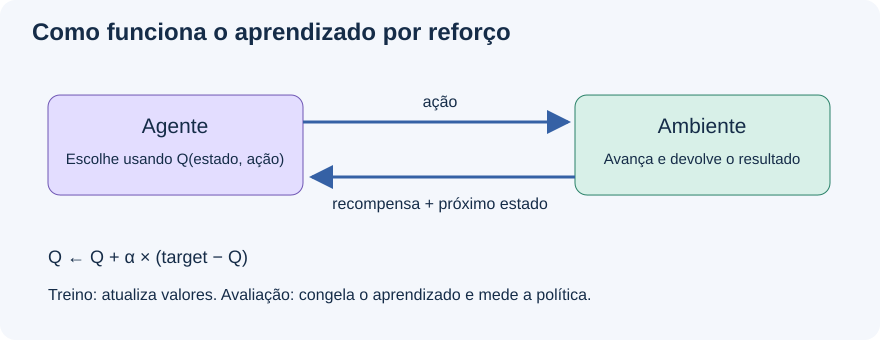
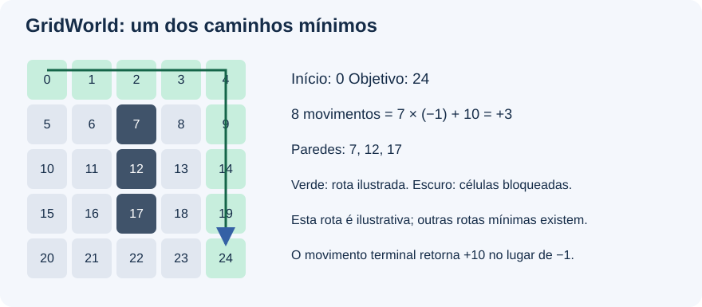
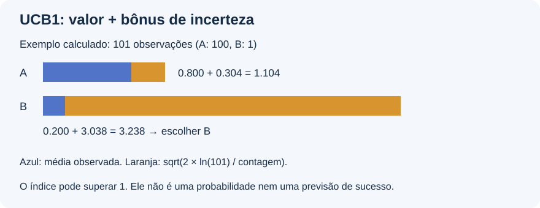

# reinforcement_engine

[](https://github.com/kleberandrade/reinforcement-engine/actions/workflows/ci.yml)
[](https://pub.dev/packages/reinforcement_engine)
[](LICENSE)

Aprenda decisões por recompensas com **Dart puro**, contratos tipados e nenhuma
dependência de runtime. Inclui Q-Learning, SARSA, Expected SARSA, Double Q,
R-learning, SARSA(λ), **Watkins Q(λ)** e **bandits** com epsilon-greedy e UCB1.

[English](README.md) · [Guia de aprendizado](doc/learning_guide.pt-BR.md) ·
[Laboratório Flutter](example/flutter_lab/README.md) · [Arquitetura](doc/architecture.md)

**[Abrir laboratório online](https://kleberandrade.github.io/reinforcement-engine/)**

Gridworld interativo: setas da política, histórico completo com média móvel e
comparação Q-Learning/SARSA, seeds e exploração
epsilon, pausa/retomada e avaliação independente. [Cenários](example/flutter_lab/README.md).

Versão do código: **0.5.0**. O badge aponta para a versão publicada no pub.dev;
um commit não comprova publicação. Os exemplos novos da 0.5 podem ser executados
a partir deste checkout. Requer Dart **3.3+**; Flutter é necessário apenas no laboratório.

## O que o aprendizado por reforço faz?

Um agente entra no labirinto sem conhecer a rota. Escolhe um movimento, recebe uma
recompensa e ajusta sua estimativa do valor futuro daquela escolha. Com vários
episódios, pode aprender uma rota útil. Você define ambiente, ações e recompensas.



**Treinar** altera estimativas e explora opções. **Avaliar** mede uma política fixa
em episódios novos. A recompensa é um sinal definido pela aplicação; não é um
rótulo nem a probabilidade de a ação estar correta.

## Escolha o modelo adequado

| Seu problema | Por onde começar | Motivo |
| --- | --- | --- |
| Escolher uma opção e observar uma recompensa imediata | `BanditAgent` com `Ucb1` ou `EpsilonGreedyBandit` | Não modela próximo estado nem retorno atrasado |
| Aprender uma rota ou sequência de decisões | `TabularAgent` com Q-Learning | Estima o valor futuro descontado das ações |
| Aprender considerando o comportamento seguido | SARSA ou Expected SARSA | Usa a próxima ação amostrada ou a média da política |
| Reduzir o viés de maximização com dois estimadores | `DoubleQAgent` | Seleciona com uma tabela e avalia com a outra |
| Propagar feedback para visitas recentes | `SarsaLambdaAgent` ou `WatkinsQLambdaAgent` | Usa traços de elegibilidade acumulativos |
| Maximizar recompensa média em tarefa contínua | `RLearningAgent` | Mantém valores relativos e estimativa de recompensa média |

São métodos tabulares para espaços finitos e discretos. Imagens brutas, bandits
contextuais, DQN, gradientes de política e controle contínuo ficam fora desta versão.

## Instale e execute

Para instalar o pacote publicado:

```sh
dart pub add reinforcement_engine
# Em Flutter: flutter pub add reinforcement_engine
```

Para usar esta versão do código, configure um checkout local no `pubspec.yaml`:

```yaml
dependencies:
  reinforcement_engine:
    path: ../reinforcement_engine
```

No repositório, execute `dart pub get` e depois `dart run example/watkins.dart`
ou `dart run example/bandits.dart`.

## Primeiro exemplo: aprender um labirinto

```dart
import 'package:reinforcement_engine/reinforcement_engine.dart';

void main() {
  final maze = GridWorld();
  final agent = TabularAgent<int, GridAction>(
    learningRate: 0.1,
    discountFactor: 0.99,
    epsilon: 1,
    epsilonDecay: 0.995,
    minEpsilon: 0.01,
    seed: 42,
  );
  for (var episode = 0; episode < 500; episode++) {
    trainEpisode(environment: maze, agent: agent, maxSteps: 200);
  }
  final report = evaluatePolicy<int, GridAction>(
    environmentFactory: GridWorld.new,
    policy: GreedyPolicy(agent.values),
    isSuccess: (state, episode) => episode.terminated && state == maze.goal,
    episodes: 20,
    maxSteps: 100,
    seed: 7,
  );
  print('Sucesso: ${report.successRate}; passos: ${report.meanSteps}');
}
```

`int` identifica a célula e `GridAction` identifica um movimento. `Q(estado, ação)`
estima um retorno descontado; não é uma probabilidade. Pares ainda não visitados
começam com valor zero. Cada movimento não terminal recebe −1; o movimento que
chega ao objetivo recebe +10.



Um episódio bem-sucedido de oito movimentos retorna **+3**: sete movimentos comuns
e um terminal. Existem outras rotas mínimas. A figura mostra uma rota válida,
sem prometer que qualquer semente a aprenderá. O [guia de avaliação](doc/evaluation.pt-BR.md)
explica taxas de sucesso, recompensas, limites e preservação do agente.

## Entenda uma atualização

No Q-Learning, o alvo não terminal é `recompensa + gamma × max Q(próximoEstado, ação)`.
A atualização aproxima a estimativa atual desse alvo:

```text
Q atual = 2     recompensa = 1     melhor próximo Q = 4
alpha = 0.25    gamma = 0.8
novo Q = 2 + 0.25 × (1 + 0.8 × 4 − 2) = 2.55
```

| Parâmetro | Significado | Cuidado comum |
| --- | --- | --- |
| `learningRate` / α | Peso do novo erro TD | Valores altos podem causar instabilidade |
| `discountFactor` / γ | Peso do valor futuro | Depende da tarefa; R-learning não usa desconto |
| `epsilon` / ε | Probabilidade de explorar no epsilon-greedy | `epsilon: 0` exige `minEpsilon: 0` |
| `lambda` / λ | Retenção dos traços junto com γ | Mais traços ativos aumentam o custo por passo |
| `averageRewardRate` / β | Taxa de atualização da recompensa média | É independente da taxa dos valores Q |

**Término** encerra a tarefa e zera o bootstrap. **Truncamento** encerra um orçamento
externo e preserva o bootstrap; o estado devolvido precisa ter ações legais.
R-learning usa seu próprio contrato contínuo e rejeita essas fronteiras.

## Watkins Q(λ): Q-Learning com memória das visitas recentes

```dart
final agent = WatkinsQLambdaAgent<int, GridAction>(lambda: 0.8, seed: 42);
for (var episode = 0; episode < 500; episode++) {
  trainEpisodic(environment: GridWorld(), agent: agent, maxSteps: 200);
}
```

O alvo usa o melhor valor legal do próximo estado. Pares recentes recebem o mesmo
erro TD, ponderado pelos traços. Quando a próxima ação amostrada não é greedy,
os traços são limpos **depois da atualização atual**. Todos os empates no máximo
contam como greedy; essa decisão ocorre antes de alterar os valores Q.
`trainEpisodic` garante limpeza nas fronteiras e em exceções. Loops manuais devem
reutilizar exatamente a próxima ação amostrada.

Com λ = 0, a atualização equivale à do Q-Learning de um passo; trajetórias com a
mesma semente podem diferir porque Watkins amostra a próxima ação antes da atualização.
Veja o [exemplo calculado de traços](doc/watkins.pt-BR.md) e execute `dart run example/watkins.dart`.

## Bandits: aprender qual opção compensa agora

```dart
import 'package:reinforcement_engine/reinforcement_engine.dart';

void main() {
  final agent = BanditAgent<String>(
    arms: ['A', 'B', 'C'], policy: const Ucb1<String>(), seed: 42,
  );
  for (var i = 0; i < 3000; i++) {
    final arm = agent.selectArm();
    // Recompensas sintéticas determinísticas; a aplicação coleta o feedback real.
    final reward = {'A': 0.2, 'B': 0.5, 'C': 0.8}[arm]!;
    agent.observe(arm, reward);
  }
  print(agent.values.mean('C'));
  print(agent.values.count('C'));
}
```

Cada braço é uma opção. Recompensas devem ser finitas e normalizadas em **[0, 1]**.
`EpsilonGreedyBandit` explora com ε fixo e, no restante, escolhe a maior média
amostral. `Ucb1` experimenta braços inéditos e depois combina média observada e
bônus de incerteza. Ambos desempatam de forma uniforme usando o gerador do agente.



O índice UCB **não é uma probabilidade** e pode superar 1. A análise pressupõe
recompensas estacionárias, independentes e limitadas. Seleção adaptativa sozinha
não comprova causalidade nem considera mudanças de contexto do usuário. Execute
`dart run example/bandits.dart` para uma simulação estocástica. O [guia de bandits](doc/bandits.pt-BR.md)
explica normalização, médias, feedback e treino limitado.

## Salve o aprendizado e crie seu ambiente

`TrainingCheckpoint` salva tabelas, configuração e exploração atual dos agentes
nativos suportados, além da recompensa média do R-learning. Double Q mantém as
duas tabelas. SARSA(λ)/Watkins Q(λ) exigem uma fronteira real de episódio sem traços
ativos. A retomada inicia uma **nova sequência aleatória**. O formato não inclui
checkpoints de bandits. [Guia de checkpoints](doc/checkpoints.pt-BR.md).

Implemente `Environment<S, A>` para tarefas sequenciais, `TdUpdateRule` para alvos
de um passo e `BanditPolicy` para seleção com recompensa imediata. Use chaves
imutáveis com igualdade/hash estáveis. IO, coleta de feedback e agendamento Flutter
pertencem à aplicação. [Guia de extensões](doc/extending.pt-BR.md).

## Aprenda praticando

| Objetivo | Exemplo executável | Guia |
| --- | --- | --- |
| Entender termos, recompensas e ciclo de treino | [Labirinto](example/reinforcement_engine_example.dart) | [Aprendizado](doc/learning_guide.pt-BR.md) |
| Comparar alvos e exploração | [Exploração](example/exploration.dart) | [Controle](doc/control.pt-BR.md) |
| Usar Watkins e entender o corte dos traços | [Watkins](example/watkins.dart) | [Watkins Q(λ)](doc/watkins.pt-BR.md) |
| Escolher opções com retorno imediato | [Bandits](example/bandits.dart) | [Bandits](doc/bandits.pt-BR.md) |
| Avaliar sem treinar | [Avaliação](example/evaluation.dart) | [Avaliação](doc/evaluation.pt-BR.md) |
| Aprender em tarefa sem estado terminal | [Manutenção](example/continuing.dart) | [R-learning](doc/continuing.pt-BR.md) |
| Salvar e retomar | [Checkpoint](example/checkpoint.dart) | [Checkpoints](doc/checkpoints.pt-BR.md) |
| Estender contratos | [Ambiente e regra personalizados](example/custom_extensions.dart) | [Extensões](doc/extending.pt-BR.md) |

## Laboratório Flutter interativo

```sh
cd example/flutter_lab
flutter pub get
flutter run -d chrome
```

Escolha seis algoritmos no labirinto, anime a rota aprendida, avalie a política,
abra a tarefa contínua de manutenção, transfira checkpoints ou acompanhe barras
de seleção dos bandits. Elas mostram **participação nas escolhas**, não chance de
sucesso. O treino é dividido em lotes entre frames. O núcleo é síncrono e independente de Flutter.

## Validação e limites

```sh
dart pub get
dart format --output=none --set-exit-if-changed lib test example benchmark validation tool
dart analyze --fatal-infos
dart test
dart run example/watkins.dart
dart run example/bandits.dart
```

O [CONTRIBUTING](CONTRIBUTING.md) reúne as verificações completas, incluindo Flutter
e consumidor independente. A reprodução depende do runtime, da ordem de ações e
dos geradores do ambiente. Não há garantia de igualdade entre runtimes. Exemplos
didáticos não estabelecem convergência geral, segurança ou desempenho em produção.
A [matriz anterior de 420 execuções](doc/benchmarks/stability.pt-BR.md) avalia
SARSA(λ)/R-learning; ela não é um benchmark destes algoritmos novos.

[Mapa do código](doc/architecture/structure.pt-BR.md) · [Diagramas de classes](doc/architecture/class_diagrams.md) ·
[Migração](doc/migration.pt-BR.md) · [Roadmap](doc/roadmap.md) · [Changelog](CHANGELOG.md)

Licença MIT. Copyright (c) 2026 Kleber Andrade.

## Artigos científicos e leituras complementares

As referências explicam os métodos. Seus resultados teóricos dependem das
respectivas hipóteses e não garantem o resultado de qualquer aplicação do pacote.

1. Sutton, R. S. (1988). **Learning to predict by the methods of temporal differences**.
   *Machine Learning, 3*, 9–44. [DOI](https://doi.org/10.1007/BF00115009).
   Base do erro TD e dos traços de elegibilidade.
2. Watkins, C. J. C. H., & Dayan, P. (1992). **Q-learning**.
   *Machine Learning, 8*, 279–292. [Página dos autores/PDF](https://www.gatsby.ucl.ac.uk/~dayan/papers/wd92.html).
   Controle off-policy de um passo; este artigo não contém o pseudocódigo de referência de Watkins Q(λ).
3. van Hasselt, H. (2010). **Double Q-learning**. *NeurIPS 23*, 2613–2621.
   [PDF dos anais](https://papers.neurips.cc/paper_files/paper/2010/file/091d584fced301b442654dd8c23b3fc9-Paper.pdf).
   Estimadores independentes usados pelo `DoubleQAgent`.
4. Auer, P., Cesa-Bianchi, N., & Fischer, P. (2002). **Finite-time Analysis of the
   Multiarmed Bandit Problem**. *Machine Learning, 47*, 235–256.
   [DOI](https://doi.org/10.1023/A:1013689704352) ·
   [PDF](https://people.eecs.berkeley.edu/~russell/classes/cs294/s11/readings/Auer%2Bal%3A2002.pdf).
   UCB1 e suas hipóteses de recompensas estacionárias limitadas; nosso epsilon fixo não é a variante de epsilon decrescente do artigo.
5. Sutton, R. S., & Barto, A. G. (2018). **Reinforcement Learning: An Introduction**,
   2ª ed. [MIT Press](https://mitpress.mit.edu/9780262039246/reinforcement-learning/).
   Livro sobre modelos de decisão, SARSA e bandits.
   Para a variante acumulativa de Watkins implementada, veja §7.6, Figura 7.15 do
   [rascunho dos autores de 2015](https://web.stanford.edu/class/psych209/Readings/SuttonBartoIPRLBook2ndEd.pdf).
