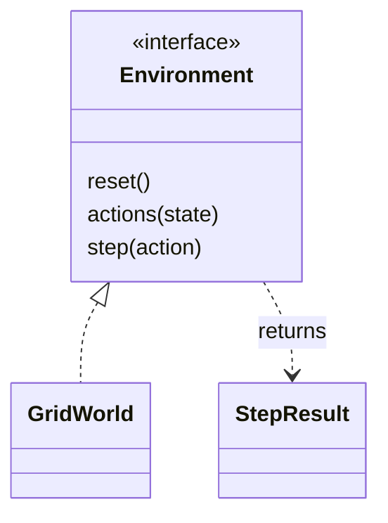
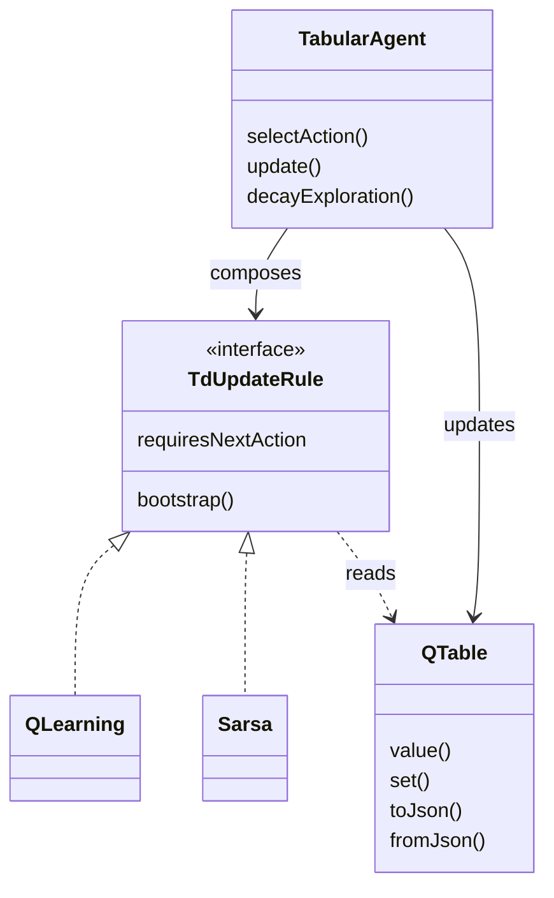
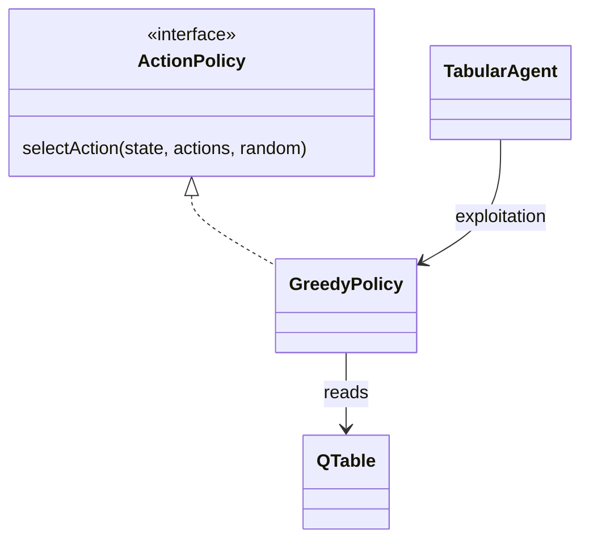
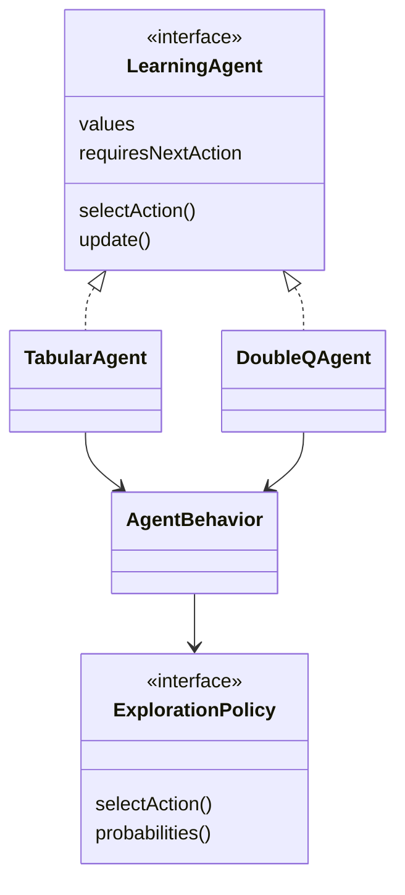
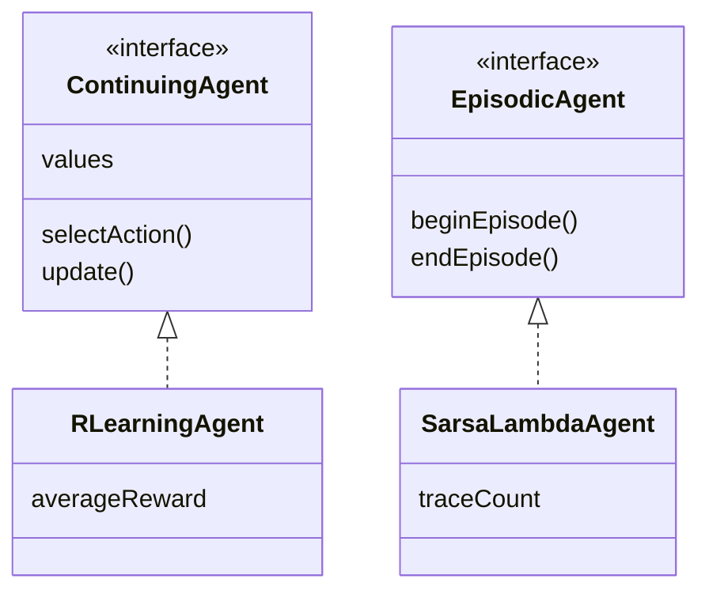
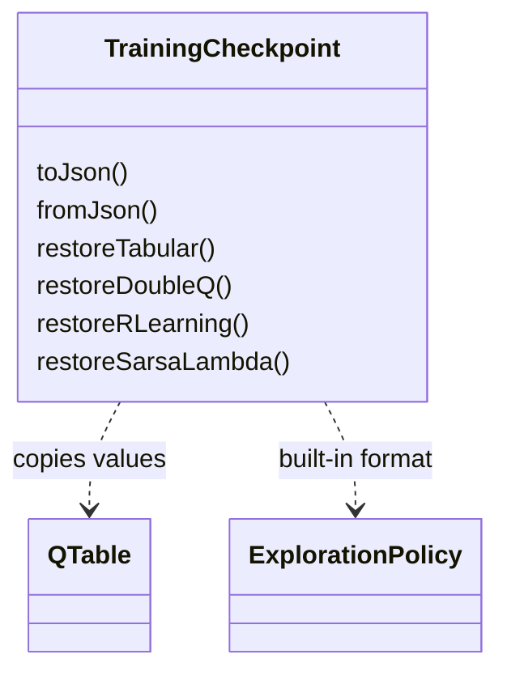

# Implemented contracts / Contratos implementados

The episode runner samples the next behavior action only when the strategy
requires it, then reuses that action at the next environment step. This is
necessary for on-policy SARSA correctness.

O runner amostra a próxima ação quando exigido pela estratégia e reutiliza essa
mesma ação no próximo passo do ambiente. Isso preserva a semântica on-policy de SARSA.

## Evaluation / Avaliação (0.2 development)

`evaluatePolicy` composes the environment and policy contracts without an agent
dependency. Its RNG and fresh environments isolate evaluation from training state.

`evaluatePolicy` combina contratos de ambiente e política sem depender do agente.
Seu RNG e ambientes novos isolam a avaliação do estado de treinamento.

## Control and exploration / Controle e exploração (0.2)

ExpectedSarsa implements the existing TdUpdateRule contract. Its probability
provider is bound to the agent's live behavior schedule by the enum constructor.
DoubleQAgent exposes SumActionValues and updates only one independent QTable per step.

ExpectedSarsa implementa TdUpdateRule com probabilidades vinculadas ao comportamento
atual. DoubleQAgent expõe SumActionValues e atualiza apenas uma tabela por passo.

## Continuing and episodic state / Estado contínuo e episódico (0.3)

The continuing runner preserves state between windows. The episodic runner wraps
the existing episode loop with guaranteed cleanup. RLearningAgent computes a
projected table update before committing average-reward arithmetic.

O runner contínuo preserva estado entre janelas. O episódico envolve o loop
existente com limpeza garantida. RLearningAgent valida uma projeção da tabela
antes de confirmar a atualização de recompensa média.

## Checkpoint adapter / Adaptador de checkpoint (0.4)

The outer persistence adapter captures supported agents and creates fresh learners.
It owns no environment or storage. Restore begins a new random stream.

O adaptador externo captura agentes suportados e cria novos agentes. Não controla
ambiente nem armazenamento. A restauração inicia outra sequência aleatória.
