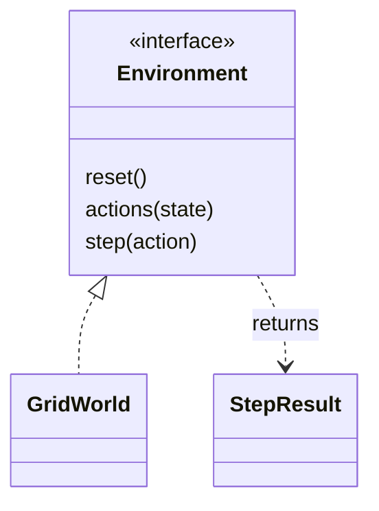
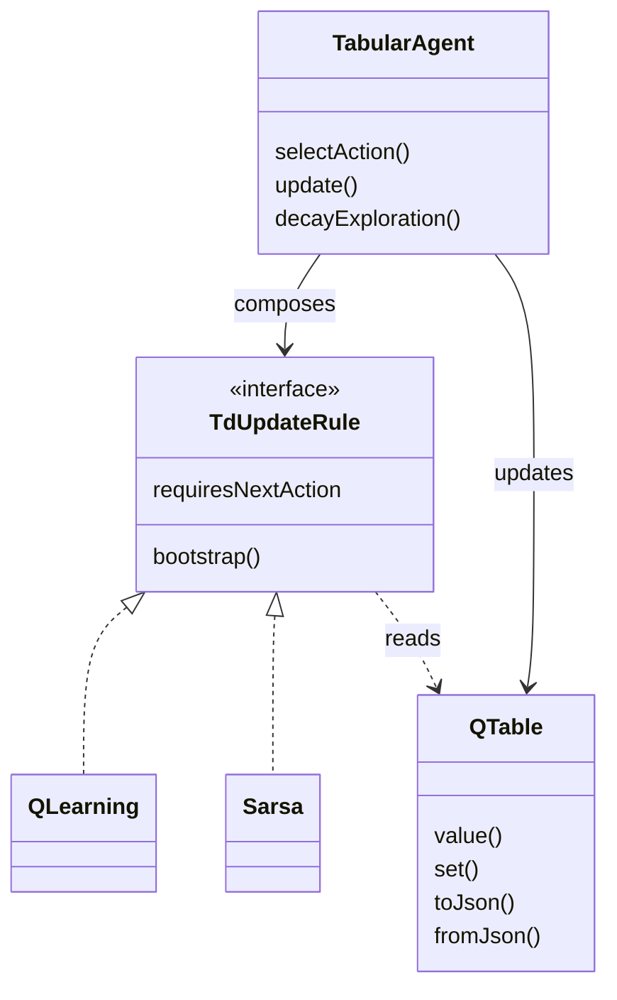
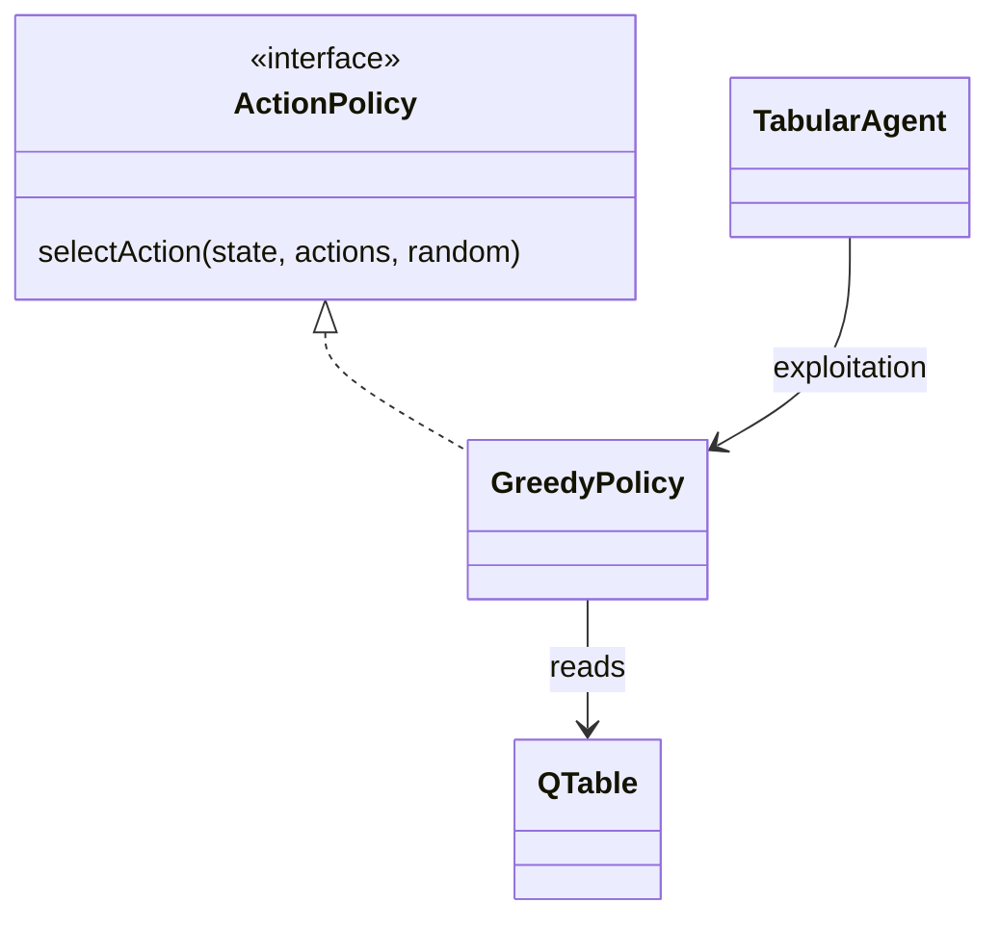

# Implemented contracts / Contratos implementados

The episode runner samples the next behavior action only when the strategy
requires it, then reuses that action at the next environment step. This is
necessary for on-policy SARSA correctness.

O runner amostra a próxima ação quando exigido pela estratégia e reutiliza essa
mesma ação no próximo passo do ambiente. Isso preserva a semântica on-policy de SARSA.

## Evaluation / Avaliação (0.2 development)

`evaluatePolicy` composes the environment and policy contracts without an agent
dependency. Its RNG and fresh environments isolate evaluation from training state.

`evaluatePolicy` combina contratos de ambiente e política sem depender do agente.
Seu RNG e ambientes novos isolam a avaliação do estado de treinamento.
