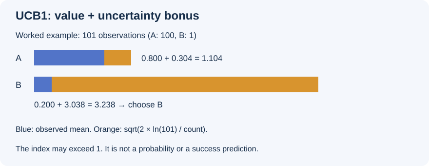

# Multi-armed bandits: choose, observe, update

[Português](bandits.pt-BR.md) · [Example](../example/bandits.dart)

A bandit selects among fixed options and learns their immediate reward means.
There is no state transition, discount or terminal flag. `BanditLearner<A>` is a
separate contract; `BanditAgent<A>` composes a `BanditPolicy<A>` and exposes live,
read-only `BanditValues<A>`. The application owns reward generation and collection.

## What the learner knows

In the synthetic example, A succeeds with probability .2, B with .5 and C with .8.
These probabilities are known to the simulator only. Each result is 0 or 1.
After observing `1, 0, 1` for one arm, its count is 3 and sample mean is 2/3.

```text
new count = old count + 1
new mean = old mean + (reward − old mean) / new count
```

Unseen means and counts are zero. Selecting does not change these statistics;
`observe(arm, reward)` records a single outcome. Immutable, unique arm keys need
stable equality/hash codes. Unknown arms, duplicate arm configuration and invalid
feedback are rejected without committing that observation.

## Two policies

| Policy | Selection | Trade-off |
| --- | --- | --- |
| `EpsilonGreedyBandit(epsilon: .1)` | Uniform exploration 10% of selections; otherwise a maximum sample mean | Simple baseline; epsilon is fixed, without automatic decay |
| `Ucb1()` | Unseen arms first; then maximum `mean + sqrt(2 ln(total) / count)` | Revisits uncertain arms; assumes stationary independent rewards in [0,1] for the usual analysis |

Ties are uniformly randomized. The initial unseen-arm order is random, rather
than fixed. `total` is the number of observations already recorded, independent
of how often selection was called. The UCB policy uses the standard index with
that documented clock; it does not expose a configurable exploration coefficient.



With 101 observations, A has n=100 and mean=.8; B has n=1 and mean=.2. The indices
are approximately 1.104 and 3.238. B is selected for information despite its lower
sample mean. Scores are not probabilities and may exceed 1. With delayed feedback,
repeated calls before observation can select the same unseen arm; this is not a
pending-request scheduler.

## Reward scale and feedback ownership

All built-in bandit observations require finite rewards in [0,1], even for
epsilon-greedy. Normalize a known bounded reward x using `(x - lower)/(upper-lower)`
with `upper > lower`, then validate it. For a bounded cost where smaller is better,
use `1 - (cost-lower)/(upper-lower)`. Bounds are application decisions. Do not
silently clamp unexpected values or change normalization bounds mid-experiment.
A sample-mean learner does not automatically adapt to a changing reward process.

The agent accepts external feedback for a legal arm; it does not track decision
IDs, pending requests or deduplication. Record each outcome once in your application.
Statistics are in memory; the existing TrainingCheckpoint format does not serialize
bandit means/counts/policy/RNG. For now an application must own any persistence.
Counts are limited to JavaScript's exact-integer range for portable arithmetic.

## Bounded training

```dart
final agent = BanditAgent<String>(
  arms: ['A', 'B'], policy: const Ucb1<String>(), seed: 42,
);
final report = trainBandit(
  agent: agent,
  pulls: 1000,
  reward: (arm) => arm == 'A' ? 0.3 : 0.7,
);
print(report.meanReward);
print(report.counts);
```

The runner is synchronous and dispatches through `BanditLearner`. Each result is
an immutable summary of that window, not lifetime counts. Invalid callbacks or
exceptions stop the run; earlier observations remain committed. Callback failures
may occur after selection advances its RNG. Use manual selection/observation for
asynchronous feedback; schedule small batches in Flutter.

The example uses separate seeded reward generators per arm and a separate policy
RNG. Equal seeds do not promise equal bits across runtimes. Its 5,000-pull scenario
is educational evidence only. No universal superiority, causal inference or
production uplift is established.

## Read next

[Learning guide](learning_guide.md) · [Extension contracts](extending.md) ·
[Scientific references](../README.md#scientific-articles-and-further-reading).
UCB1 follows the index in Auer, Cesa-Bianchi and Fischer (2002), Figure 1. The
fixed-epsilon baseline is distinct from the paper's decaying-epsilon algorithm.
