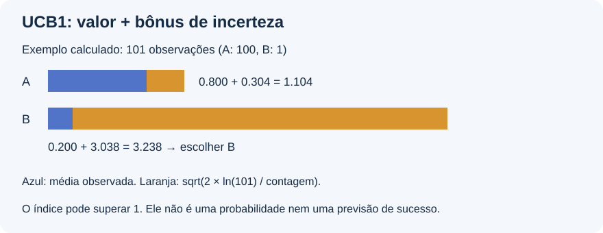

# Bandits: escolher, observar, atualizar

[English](bandits.md) · [Exemplo](../example/bandits.dart)

Um bandit escolhe entre opções fixas e aprende suas médias de recompensa imediata.
Não há transição de estado, desconto ou estado terminal. `BanditLearner<A>` é um
contrato próprio. `BanditAgent<A>` compõe uma `BanditPolicy<A>` e expõe estatísticas
vivas de leitura por `BanditValues<A>`. A aplicação controla geração e coleta do feedback.

## O que o agente sabe

No exemplo sintético, A tem chance de sucesso .2, B .5 e C .8. Somente o simulador
conhece essas probabilidades. Cada resultado observado é 0 ou 1. Após observar
`1, 0, 1` em uma opção, a contagem é 3 e a média amostral é 2/3.

```text
nova contagem = contagem anterior + 1
nova média = média anterior + (recompensa − média anterior) / nova contagem
```

Médias e contagens inéditas são zero. Selecionar não altera esses dados;
`observe(arm, reward)` registra um resultado. Braços devem ser chaves únicas e
imutáveis, com igualdade/hash estáveis. Opções desconhecidas, duplicadas na
configuração e feedback inválido são rejeitados sem confirmar aquela observação.

## Duas políticas

| Política | Seleção | Característica |
| --- | --- | --- |
| `EpsilonGreedyBandit(epsilon: .1)` | Exploração uniforme em 10% das escolhas; no restante, maior média amostral | Referência simples, com epsilon fixo e sem decaimento automático |
| `Ucb1()` | Opções inéditas primeiro; depois maior `média + sqrt(2 ln(total) / contagem)` | Revisa opções incertas; a análise usual pressupõe recompensas estacionárias independentes em [0,1] |

Empates são sorteados uniformemente. A ordem inicial das opções inéditas é
aleatória. `total` conta observações registradas, não chamadas de seleção. A
política usa o índice padrão com esse relógio documentado; não recebe coeficiente
de exploração configurável.



Com 101 observações, A tem n=100 e média=.8; B tem n=1 e média=.2. Os índices
aproximados são 1.104 e 3.238. B é escolhida para obter informação, apesar de sua
média menor. Índices não são probabilidades e podem superar 1. Com feedback
atrasado, várias seleções antes da observação podem repetir uma opção inédita;
o agente não agenda requisições pendentes.

## Escala e responsabilidade pelo feedback

Todos os agentes bandit nativos exigem recompensas finitas em [0,1], inclusive
epsilon-greedy. Para recompensa x com limites conhecidos, normalize por
`(x - mínimo)/(máximo-mínimo)`, com `máximo > mínimo`, e valide. Para custo limitado
em que menor é melhor, use `1 - (custo-mínimo)/(máximo-mínimo)`. A aplicação define
os limites. Não recorte resultados inesperados silenciosamente nem mude a escala
durante o experimento. A média amostral não acompanha mudanças automaticamente.

O agente aceita feedback externo para qualquer braço legal, mas não controla IDs
de decisão, pendências ou deduplicação. A aplicação registra cada resultado uma
única vez. Os dados ficam em memória. O formato TrainingCheckpoint não serializa
médias, contagens, política ou gerador dos bandits; a persistência pertence à
aplicação. As contagens respeitam o limite de inteiros exatos de JavaScript.

## Treino com limite

```dart
final agent = BanditAgent<String>(
  arms: ['A', 'B'], policy: const Ucb1<String>(), seed: 42,
);
final report = trainBandit(
  agent: agent,
  pulls: 1000,
  reward: (arm) => arm == 'A' ? 0.3 : 0.7,
);
print(report.meanReward);
print(report.counts);
```

O runner é síncrono e usa `BanditLearner`. O resultado é um resumo imutável daquela
janela; as contagens não incluem janelas anteriores. Callback inválido ou exceção
interrompe o treino e preserva observações anteriores. O gerador pode já ter
avançado na seleção. Use seleção/observação manuais para feedback assíncrono e
agende pequenos lotes no Flutter.

O exemplo usa geradores de recompensa por braço, separados do gerador da política.
Sementes iguais não garantem bits idênticos entre runtimes. O cenário de 5.000
escolhas é didático e não estabelece superioridade geral, causalidade ou ganho em produção.

## Próximas leituras

[Guia de aprendizado](learning_guide.pt-BR.md) · [Extensões](extending.pt-BR.md) ·
[Referências científicas](../README.pt-BR.md#artigos-científicos-e-leituras-complementares).
UCB1 segue o índice da Figura 1 de Auer, Cesa-Bianchi e Fischer (2002). Nosso epsilon
fixo é diferente do algoritmo de epsilon decrescente do artigo.
