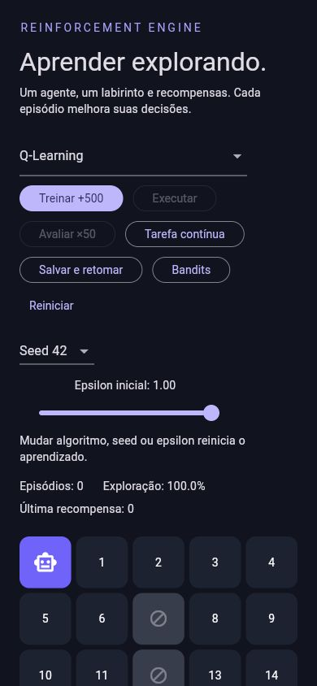

# Interactive laboratory validation — 2026-11-17

## Scope and implementation

Working copy: `reinforcement_engine`, branch `main`, origin
`https://github.com/kleberandrade/reinforcement-engine.git`. Started clean at
`0f4d825`; release checkouts and steering-engine were not modified. The latter's
Pages workflow and lab guide were read as references. No shared Flutter SDK was
modified: local checks used a dedicated copy of Flutter 3.50.0 / Dart 3.14.0.

The existing six maze algorithms remain engine implementations. This revision
adds outer UI controls and observability; no changes were needed in `lib/`.
Playback now uses a separate GridWorld, GreedyPolicy and Random(7), keeping the
training environment and RNG untouched. Bounded training preserves episode
lifecycle and truncation behavior. Reset disposes work; pause retains the batch
or playback position; cancel retains the model. The history retains episode
returns in memory until reset and renders the latest 50.

## Executed checks

- 92 pure Dart behavioral tests passed; root analysis passed with fatal infos.
- Required formatting check passed across lib/test/example/benchmark/validation/tool.
- Ten VM examples ran; custom_extensions compiled to JavaScript and ran in Node.
- Documentation SVG generator ran with no changes to the existing SVGs.
- Independent `validation/contracts_03` consumer analysis and execution passed.
- Flutter analysis passed with fatal infos.
- 15 Flutter widget tests passed. The suite covers all six default maze algorithms reaching eight
  steps at 100% success, training pause/resume/cancel, playback pause/resume,
  reset during active work, 360×800 with 200% text, accessible target labels and
  Android target sizes, checkpoint import/export and bandit interactions.
- Observation regression compares 1,000 episode returns with and without an
  intervening 50-episode evaluation and greedy playback.
- Flutter Web release build succeeded with bundled web resources and
  `/reinforcement-engine/` base-href; its Wasm compatibility dry run succeeded.
  A Wasm deployment was not built or browser-tested.

The real Chrome run used the release build served under the same repository
subpath: 500 Q-Learning episodes, evaluation showing 100% / 8.0 steps, playback
reaching the goal in eight moves, grid policy labels and recent reward bars.
Desktop and 390×844 browser viewports were inspected. The mobile controls wrap
and the content scrolls. Captures are real browser screenshots, not mockups:

## Dependencies and limits

Direct dev packages resolved to their latest compatible versions; compatible
transitive Dart tooling was upgraded locally. The Flutter application lockfile is
tracked and CI pins Flutter 3.50.0. Flutter pins material_color_utilities 0.13.0
and test_api 0.7.14; catalog versions 0.13.1 and 0.7.15 are incompatible with this
SDK's packages. No overrides were introduced. The library lockfile remains
untracked by the existing package policy.

The installed crapper, dryer (threshold .8) and mutator scan were invoked against
the Flutter sources. They report no supported source files because these tools
do not support Dart. This is not a CRAP/duplication score or mutation-test pass.
Behavioral regression tests are the evidence available here.

Automated accessibility checks do not establish WCAG compliance; no manual
screen-reader audit was performed. Seed 42's success in this deterministic maze
is not a general learning guarantee or statistical comparison. Different runtimes
can implement different Random sequences. Other lab pages retain their own reset
and navigation lifecycle; maze pause is not a global worker controller.

MIT attribution was retained. No third-party figures were copied, no pub.dev
release was made and no service was purchased.

## Publication

Pages was absent before this revision. It was enabled with Actions as the build
source. The new job depends on both Dart matrix jobs and the Flutter job and only
publishes main outside pull requests. Final hosted result is recorded below
when verified; configuration alone is not publication evidence.
