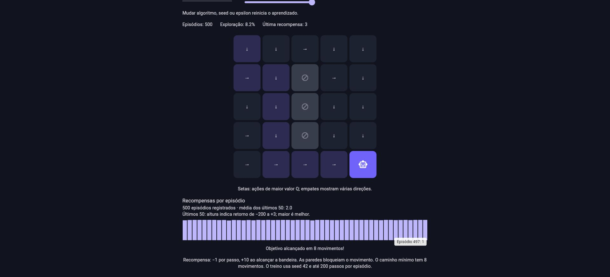

# Interactive laboratory validation — 2026-11-17

## Scope and implementation

Working copy: `reinforcement_engine`, branch `main`, origin
`https://github.com/kleberandrade/reinforcement-engine.git`. Started clean at
`0f4d825`; release checkouts and steering-engine were not modified. The latter's
Pages workflow and lab guide were read as references. No shared Flutter SDK was
modified: local checks used a dedicated copy of Flutter 3.50.0 / Dart 3.14.0.

The existing six maze algorithms remain engine implementations. This revision
adds outer UI controls and observability; no changes were needed in `lib/`.
Playback now uses a separate GridWorld, GreedyPolicy and Random(7), keeping the
training environment and RNG untouched. Bounded training preserves episode
lifecycle and truncation behavior. Reset disposes work; pause retains the batch
or playback position; cancel retains the model. The history retains episode
returns in memory until reset and renders every episode. The chart now uses trailing means over 10/25/50/100
samples (default 25), without padding at the beginning. Switching algorithms
retains the latest immutable Q-Learning/SARSA reference under the same settings;
seed/epsilon changes and explicit reset clear comparisons.

## Executed checks

- 92 pure Dart behavioral tests passed; root analysis passed with fatal infos.
- Required formatting check passed across lib/test/example/benchmark/validation/tool.
- Ten VM examples ran; custom_extensions compiled to JavaScript and ran in Node.
- Documentation SVG generator ran with no changes to the existing SVGs.
- Independent `validation/contracts_03` consumer analysis and execution passed.
- Flutter analysis passed with fatal infos.
- 15 Flutter widget tests passed. The suite covers all six default maze algorithms reaching eight
  steps at 100% success, training pause/resume/cancel, playback pause/resume,
  reset during active work, 360×800 with 200% text, accessible target labels and
  Android target sizes, checkpoint import/export and bandit interactions.
- Observation regression compares 1,000 episode returns with and without an
  intervening 50-episode evaluation and greedy playback.
- Flutter Web release build succeeded with bundled web resources and
  `/reinforcement-engine/` base-href; its Wasm compatibility dry run succeeded.
  A Wasm deployment was not built or browser-tested.

The real Chrome run used the release build served under the same repository
subpath: 500 Q-Learning episodes, evaluation showing 100% / 8.0 steps, playback
reaching the goal in eight moves, grid policy labels and complete reward curves with moving means.
Desktop and 390×844 browser viewports were inspected. The mobile controls wrap
and the content scrolls. Captures are real browser screenshots, not mockups:

## Dependencies and limits

Direct dev packages resolved to their latest compatible versions; compatible
transitive Dart tooling was upgraded locally. The Flutter application lockfile is
tracked and CI pins Flutter 3.50.0. Flutter pins material_color_utilities 0.13.0
and test_api 0.7.14; catalog versions 0.13.1 and 0.7.15 are incompatible with this
SDK's packages. No overrides were introduced. The library lockfile remains
untracked by the existing package policy.

The installed crapper, dryer (threshold .8) and mutator scan were invoked against
the Flutter sources. They report no supported source files because these tools
do not support Dart. This is not a CRAP/duplication score or mutation-test pass.
Behavioral regression tests are the evidence available here.

Automated accessibility checks do not establish WCAG compliance; no manual
screen-reader audit was performed. Seed 42's success in this deterministic maze
is not a general learning guarantee or statistical comparison. Different runtimes
can implement different Random sequences. Other lab pages retain their own reset
and navigation lifecycle; maze pause is not a global worker controller.

MIT attribution was retained. No third-party figures were copied, no pub.dev
release was made and no service was purchased.

## Publication

Pages was absent before this revision. It was enabled with Actions as the build
source. The new job depends on both Dart matrix jobs and the Flutter job and only
publishes main outside pull requests. Deployment of source revision `dbbeb66` succeeded in
[Actions run 44168240494](https://github.com/kleberandrade/reinforcement-engine/actions/runs/44168240494).
Both Dart jobs (3.3.0 and stable), Flutter and Pages completed successfully.

[The published laboratory](https://kleberandrade.github.io/reinforcement-engine/)
returned HTTP 200, as did `flutter_bootstrap.js`, `main.dart.js` and bundled
`canvaskit/canvaskit.js`. Served HTML has `lang="pt-BR"` and the correct repository
base path. GitHub About now links to the lab; all eight existing topics were
retained. The existing pub badge resolves to published version 0.5.0 and the CI
badge endpoint returns 200. These checks do not imply a new package release.

A final documentation-only commit records these results and links with CI
explicitly skipped; it does not alter the deployed application sources.

## Full-history reward comparison revision

Added numerical mean tests (initial partial windows, expired samples, empty input
and invalid window), episode-1 inspection after 100 samples, an actual window
selection changing the mean, unequal run lengths without invented samples,
Q-Learning/SARSA preservation and seed/reset invalidation. Populated chart tests
exercise 360×800 with 200% text. Axis label space scales with text after this test
found wrapping in the original fixed-width axis.

Real Chrome validation trained both algorithms for 500 episodes with seed 42
and epsilon 1, and inspected their overlaid full histories on desktop and at
390×844. Changed the smoothing window through the browser control. New captures
are reward-comparison.jpg and reward-comparison-mobile.jpg. Other screenshots
above retain the earlier maze walkthrough; the old 50-bar chart is superseded.

The helper and renderer live inside the Flutter application. No core API,
learning algorithms, runtime dependencies or shared SDK were changed. The three
installed quality tools were invoked again; they still do not support Dart,
so empty scans are not counted as quality or mutation passes.

Final local revision checks: **19 Flutter tests passed**, including the new chart
controls and populated accessibility layout case. Fatal-info Flutter analysis,
release Web build and Wasm compatibility dry run passed. The 92 core tests,
required VM examples, independent contracts consumer, SVG check and JavaScript
compile/execution passed again. No dependencies were added for chart rendering.

Hosted revision verification: source `f49024d` passed Dart 3.3.0, Dart stable,
Flutter and Pages in [Actions run 44171550439](https://github.com/kleberandrade/reinforcement-engine/actions/runs/44171550439).
The site, bootstrap and application JavaScript returned HTTP 200; the published
JavaScript includes the new full-history comparison interface. Its SHA-256 was
`4f0c30e1e678bebbfd6ca2146586ba64ab200ef430dc07727c7ac2b6c683a577`.
A final documentation-only commit records this result without rebuilding the
unchanged application.

## Paired training and responsive dashboard revision

**Treinar juntos** creates fresh Q-Learning and SARSA agents from one
LabParameters configuration: selected seed/epsilon, alpha .2, gamma .99, epsilon
multiplier .995, floor .01 and 200-step limit. Each owns an independent RNG and
GridWorld. One UI timer interleaves ten complete pairs per tick, up to 500 pairs;
this is bounded main-thread work, not parallel CPU workers. Both histories pause,
resume or cancel together. Repeating starts from zero; reset clears both.

A numerical test compares 40 paired episodes with independently trained baselines
for each algorithm at seed 7/epsilon .6 and checks equal exploration schedules,
learning rate and discount factor. The peer reward snapshot cannot be mutated.
UI tests cover repeatable 500/500 runs, pause/cancel/reset and primary-only +500
continuation while keeping the peer history fixed. Existing observation isolation,
six-algorithm learning and populated 200%-text chart cases remain in the suite.

Chrome inspection verified paired 500/500 runs, pause at 30/30, resume/cancel at
70/70, reset to zero and another fresh completed run. The default desktop and
390×844 viewports were inspected. New screenshots show the responsive dashboard
and paired curves: joint-training-desktop.jpg, joint-training-curves.jpg and
joint-training-mobile.jpg. Completed-state captures are real app screenshots.

Automated checks now include text contrast, labeled controls and Android target
sizes before and during joint training. The selected parameter values retain
readable text while disabled. Separate semantic groups keep progress and buttons
individually exposed. These checks do not replace a manual screen-reader audit
or establish WCAG certification. Mobile panels scroll; the chart retains every
recorded episode. Grid/playback/evaluation show Q-Learning after a joint run;
SARSA's history and exploration are separately identified.

Final local results for this revision: **21 Flutter tests passed**, including
contrast before/during training, synchronized pair lifecycle and individual
continuation. Fatal-info Flutter analysis, Web release build (repository base
path, bundled render resources) and Wasm compatibility dry run passed. Required
format checks passed across 87 Dart files. The 92 core tests, ten VM examples,
external consumer, JS execution and SVG consistency checks also passed; core
sources and dependency manifests were not changed. Hosted result follows after
verification of the deployed revision.
