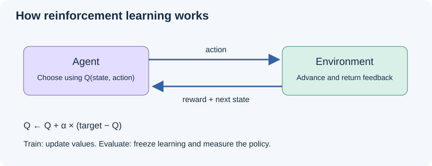
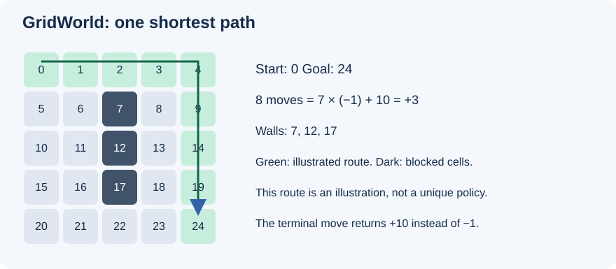

# From rewards to a learned policy

[Português](learning_guide.pt-BR.md) · [README](../README.md)

Start with the maze, then compare traces and immediate-reward bandits. All examples
use the public import and keep storage, scheduling and feedback outside the core.

## 1. Name the pieces

| Term | Plain meaning | In GridWorld |
| --- | --- | --- |
| Agent | The learner choosing what to do | `TabularAgent<int, GridAction>` |
| Environment | The system affected by actions | `GridWorld` |
| State | Information used to choose | Cell number 0–24 |
| Action | One legal choice | Up, right, down, left |
| Reward | Immediate numerical feedback | −1 or +10 |
| Return | Sum of future rewards, possibly discounted | Objective estimated by Q |
| Policy | Rule for selecting actions | Epsilon-greedy or greedy evaluation |
| Episode | One run until termination or a budget boundary | Start to goal, or step cap |
| Q-value | Estimated return for a state/action pair | Value of moving right at cell 0 |
| Bootstrap | Using an estimate as part of another target | `gamma * max Q(nextState, a)` |
| Trace | Temporary eligibility for receiving later TD errors | Recently visited pairs |
| Arm | One immediate-reward option in a bandit | A, B or C |



## 2. Define the objective before tuning

A reward of −1 per ordinary step and +10 on reaching the goal encourages shorter
successful episodes. A wall collision also costs −1 because it consumes a step.
The eight-move route returns 3, not 2: the terminal move pays +10 instead of −1.
The reported episode reward is undiscounted even when Q-learning uses gamma < 1.



Changing rewards changes the task. More positive feedback is not automatically a
better design: rewarding movement alone could encourage endless loops. Verify your
termination rule, reward scale, available actions and reachable goal first.

## 3. Run, then measure separately

```sh
dart pub get
dart run example/reinforcement_engine_example.dart
dart run example/evaluation.dart
```

Training explores and changes the tables. `evaluatePolicy` uses a separate policy
and RNG on fresh environments; the caller defines success. Check success rate,
mean steps, mean reward and truncation rate together. A low step average is not
meaningful if most episodes fail. Repeated evaluation of a fixed seeded task is
not evidence about unseen real-world tasks.

For the complete minimal train/evaluate program, copy the first README example.
Try 50 versus 500 episodes while holding the seed and other parameters fixed.
Record all failures instead of reporting only successful episodes.

## 4. Read an update by hand

Suppose Q = 2, reward = 1, next maximum = 4, alpha = .25 and gamma = .8.
The target is 4.2; the TD error is 2.2; the increment is .55; new Q is **2.55**.
With termination, the target is just 1 and new Q is **1.75** instead.
Truncation retains the next-state estimate; it is not termination.

SARSA uses the next actual behavior action rather than a maximum. Expected SARSA
averages all next values under current behavior probabilities. Double Q separates
selection and evaluation across two tables. R-learning estimates relative values
and average reward, with no discount or terminal state.

## 5. Decide whether traces help your task

Run `dart run example/eligibility_traces.dart` and `dart run example/watkins.dart`.
SARSA(λ) propagates along the sampled behavior. Watkins Q(λ) bootstraps from a
maximum and cuts eligibility when the next action is nongreedy. A larger lambda
is not universally better; trace work is proportional to the active pairs.
[Trace walkthrough](watkins.md).

Use `trainEpisodic` for either trace agent. It calls `beginEpisode/endEpisode`
even on errors. Direct `trainEpisode` does not own trace cleanup on truncation.

## 6. Use a bandit when feedback is immediate

Run `dart run example/bandits.dart`. There is one list of options and a feedback
value per selection, with no next-state return. Bandits can illustrate choosing
among alternative configurations with normalized immediate rewards. If choices
change the future state or delayed objective, use an explicit sequential model.
[Bandit guide](bandits.md).

## 7. Resume and integrate

Run `dart run example/checkpoint.dart` before adding storage. A checkpoint preserves
learning state, but resumes with a new RNG stream. Capture at episode/window
boundaries and validate application-owned environment identity and codecs.
[Checkpoint contract](checkpoints.md).

The Flutter lab visualizes the maze, continuing maintenance, checkpoints and bandit
selection shares. Core runners are synchronous: keep batches small between frames,
or schedule an isolate in your application. [Lab](../example/flutter_lab/README.md).

## Common troubleshooting

| Symptom | Check first |
| --- | --- |
| Constructor rejects `epsilon: 0` | Also set `minEpsilon: 0` |
| Agent loops instead of finishing | Reward design, reachable goal, legal actions and maxSteps |
| Different results after load | Checkpoints start a new RNG stream; environment/counters are caller-owned |
| Values are erratic | Reward scale, learning rate, bootstrap and task stationarity |
| UI stops rendering | Split synchronous training into bounded batches |
| UCB index exceeds 1 | Expected: it is mean plus an uncertainty bonus, not a probability |
| Bandit counts grow unexpectedly | Record feedback once; selection does not record an observation |
| Trace checkpoint fails | Finish the episode; active traces are rejected |

Use the [README references](../README.md#scientific-articles-and-further-reading)
to study assumptions, then use tests and task-specific experiments to validate
an application. The illustrations here are original explanations, not paper figures.
