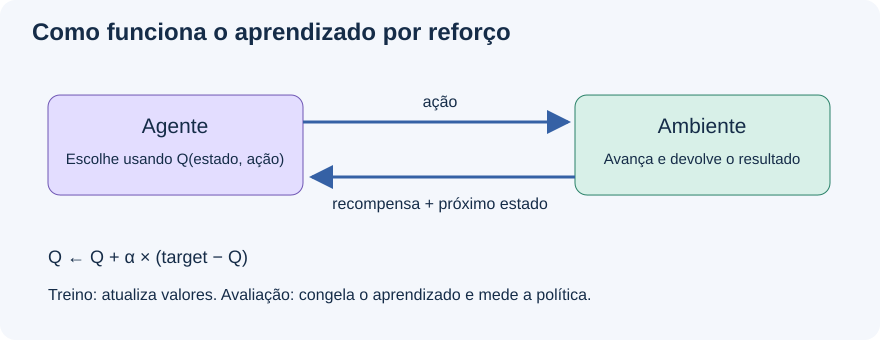
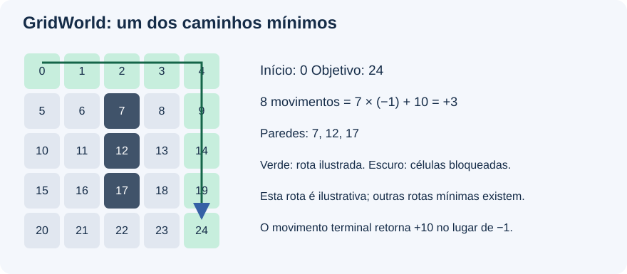

# Da recompensa à política aprendida

[English](learning_guide.md) · [README](../README.pt-BR.md)

Comece pelo labirinto e depois compare traços e bandits de retorno imediato. Os
exemplos usam a importação pública; armazenamento, agendamento e feedback ficam na aplicação.

## 1. Dê nome às peças

| Termo | Significado simples | No GridWorld |
| --- | --- | --- |
| Agente | Quem aprende a escolher | `TabularAgent<int, GridAction>` |
| Ambiente | Sistema afetado pelas ações | `GridWorld` |
| Estado | Informação usada na escolha | Número de célula entre 0 e 24 |
| Ação | Uma escolha legal | Cima, direita, baixo, esquerda |
| Recompensa | Feedback numérico imediato | −1 ou +10 |
| Retorno | Soma de recompensas futuras, possivelmente descontadas | Objetivo estimado por Q |
| Política | Regra para escolher ações | Epsilon-greedy ou avaliação greedy |
| Episódio | Execução até término ou limite externo | Do início ao objetivo, ou limite de passos |
| Valor Q | Estimativa do retorno de um par estado/ação | Valor de ir à direita na célula 0 |
| Bootstrap | Usar uma estimativa no alvo de outra | `gamma * max Q(próximoEstado, ação)` |
| Traço | Elegibilidade temporária para receber erros TD posteriores | Pares visitados recentemente |
| Braço | Uma opção de recompensa imediata em um bandit | A, B ou C |



## 2. Defina o objetivo antes de ajustar parâmetros

Recompensar passos comuns com −1 e a chegada com +10 incentiva episódios curtos e
bem-sucedidos. Colidir com a parede também custa −1, porque consome um passo.
A rota de oito movimentos retorna 3, não 2: a chegada paga +10 em vez de −1.
A recompensa total reportada no episódio não é descontada, mesmo com gamma < 1.



Alterar recompensas muda a tarefa. Mais feedback positivo não significa um projeto
melhor: premiar apenas movimento pode incentivar ciclos infinitos. Verifique
regras de término, escala, ações disponíveis e se o objetivo é alcançável.

## 3. Execute e depois meça separadamente

```sh
dart pub get
dart run example/reinforcement_engine_example.dart
dart run example/evaluation.dart
```

O treino explora e altera tabelas. `evaluatePolicy` usa outra política e outro
gerador em ambientes novos; a aplicação define sucesso. Observe juntos taxa de
sucesso, média de passos, recompensa e taxa de truncamento. Poucos passos não
significam bom resultado se a maioria falhar. Repetir uma avaliação sintética com
semente fixa não comprova desempenho em tarefas reais desconhecidas.

Copie o primeiro programa do README para um treino/avaliação completo. Compare
50 e 500 episódios mantendo os demais parâmetros e a semente. Registre todas as
falhas, em vez de considerar somente os episódios que chegaram ao objetivo.

## 4. Calcule uma atualização à mão

Com Q = 2, recompensa = 1, máximo seguinte = 4, alpha = .25 e gamma = .8,
o alvo é 4.2, o erro TD é 2.2, o incremento é .55 e o novo Q é **2.55**.
Se houver término, o alvo é apenas 1 e o novo Q é **1.75**.
Truncamento preserva a estimativa seguinte; não é término.

SARSA usa a próxima ação realmente amostrada, em vez do máximo. Expected SARSA
pondera os valores seguintes pelas probabilidades atuais de comportamento.
Double Q separa seleção e avaliação em duas tabelas. R-learning usa valores
relativos e recompensa média, sem desconto nem estado terminal.

## 5. Decida se os traços ajudam a tarefa

Execute `dart run example/eligibility_traces.dart` e `dart run example/watkins.dart`.
SARSA(λ) propaga conforme o comportamento amostrado. Watkins Q(λ) usa bootstrap
máximo e corta a elegibilidade quando a próxima ação não é greedy. Lambda maior
não é sempre melhor; o trabalho por passo cresce com os pares ativos.
[Exemplo de traços](watkins.pt-BR.md).

Use `trainEpisodic` com os dois agentes. Ele chama `beginEpisode/endEpisode` até
em erros. `trainEpisode` sozinho não controla limpeza no truncamento.

## 6. Use bandit quando o feedback for imediato

Execute `dart run example/bandits.dart`. Há uma lista de opções e um feedback por
escolha, sem retorno de próximo estado. Um exemplo é escolher configurações com
recompensa imediata normalizada. Se a escolha muda o estado futuro ou o objetivo
atrasado, modele uma tarefa sequencial explícita. [Guia de bandits](bandits.pt-BR.md).

## 7. Retome e integre

Execute `dart run example/checkpoint.dart` antes de adicionar armazenamento. O
checkpoint preserva o aprendizado e inicia outro gerador aleatório. Capture entre
episódios/janelas e valide identidade do ambiente e codecs da aplicação.
[Contrato de checkpoint](checkpoints.pt-BR.md).

O laboratório Flutter mostra labirinto, manutenção, checkpoints e participação dos
bandits nas escolhas. Runners são síncronos: use lotes pequenos entre frames ou um
isolate controlado pela aplicação. [Laboratório](../example/flutter_lab/README.md).

## Dificuldades comuns

| Sintoma | O que verificar primeiro |
| --- | --- |
| Construtor rejeita `epsilon: 0` | Configure também `minEpsilon: 0` |
| Agente entra em ciclos | Recompensa, objetivo alcançável, ações legais e maxSteps |
| Resultado diferente após carregar | Retomada inicia outro gerador; ambiente/contadores são externos |
| Valores oscilam muito | Escala das recompensas, alpha, bootstrap e estacionariedade |
| Interface não renderiza | Divida o treino síncrono em lotes limitados |
| Índice UCB passa de 1 | É média mais bônus de incerteza; não é probabilidade |
| Contagens dos bandits crescem demais | Registre feedback uma vez; selecionar não registra observação |
| Checkpoint de traços é rejeitado | Termine o episódio; traços ativos não são descartados |

As [referências do README](../README.pt-BR.md#artigos-científicos-e-leituras-complementares)
explicam as hipóteses. Testes e experimentos da tarefa validam a aplicação.
As ilustrações são explicações originais, não figuras copiadas de artigos.
