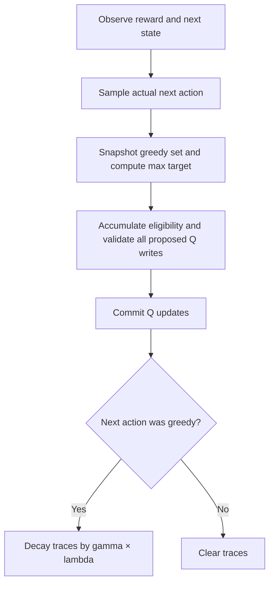

# Watkins Q(λ), step by step

[Português](watkins.pt-BR.md) · [Example](../example/watkins.dart)

Use `WatkinsQLambdaAgent<S, A>` with `trainEpisodic`. It implements `EpisodicAgent`
and reuses the existing environment/runner contracts without agent type checks.
The variant here uses accumulating traces, not replacing or true-online traces.

## One numerical episode

Set alpha = .5, gamma = 1, lambda = .8 and initialize all Q-values to zero.
At state 0 take `go`, receive 0 and reach state 1. The next action is greedy
(all unseen actions tie). The TD error is zero; the retained eligibility of
`(0, go)` becomes .8. Then take `go` at state 1 and receive terminal reward 10.

| Pair | Eligibility for terminal update | Increment | Final Q |
| --- | --- | --- | --- |
| `(0, go)` | .8 | .5 × 10 × .8 = 4 | 4 |
| `(1, go)` | 1 | .5 × 10 × 1 = 5 | 5 |

For a contrasting nongreedy branch, initialize another action at state 1 with
value 1 and keep `go` at zero. Choose `go` as the next action: the first target is
1, so `(0, go)` becomes .5, but its eligibility is then cleared. The later
terminal reward updates only `(1, go)`; `(0, go)` stays .5. With an all-zero table,
every legal action is tied for the maximum, so none is strictly nongreedy.
An exploration RNG event alone does not imply a nongreedy choice.

## Update order and ties

Greediness is determined from legal next actions BEFORE Q writes. Any tied maximum
counts as greedy, including one selected during random exploration. No arbitrary
argmax tie winner cuts another tied action. Termination ignores next actions,
uses zero bootstrap, propagates the current error and clears traces.

Truncation preserves bootstrap; `trainEpisodic` then clears eligibility. Manual
loops must call `beginEpisode/endEpisode`, supply the actual legal next action and
reuse it at the next transition. The current update propagates existing traces
before cutting them for a nongreedy next action. This is Watkins, not naive Q(λ).

## Parameters, failure and persistence

Alpha is in (0,1], gamma and lambda in [0,1]. Behavior uses the same composable
exploration contract as other agents. Nonfinite rewards/bootstrap/updates fail;
all trace updates are staged so an overflow cannot partly commit a table.
Invalid calls preserve Q and eligibility, while action sampling may have already
advanced the RNG. Begin/end only clears traces.

With lambda zero, identical explicit transitions produce one-step Q-learning
updates. The default Q-learning runner samples its next action after Q writes;
Watkins samples before, so same-seed end-to-end trajectories need not match.
Work is O(active pairs) per update, without threshold pruning. Frequent nongreedy
behavior cuts traces often; longer traces do not guarantee faster learning.

Use `TrainingCheckpoint.watkinsQLambda` / `restoreWatkinsQLambda` at a true episode
boundary; active traces are rejected. Restore starts a new random stream. Old 0.4
checkpoint readers reject the new kind; existing old kinds retain version 1.

## Algorithm source

This order follows Sutton and Barto's accumulating-trace Watkins pseudocode,
§7.6, Figure 7.15 of the [2015 in-progress draft](https://web.stanford.edu/class/psych209/Readings/SuttonBartoIPRLBook2ndEd.pdf).
The one-step Q-learning article and trace foundations are listed at the
[end of the README](../README.md#scientific-articles-and-further-reading).
