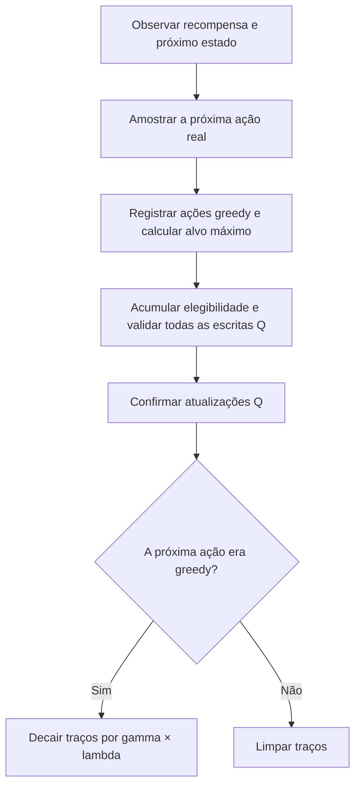

# Watkins Q(λ), passo a passo

[English](watkins.md) · [Exemplo](../example/watkins.dart)

Use `WatkinsQLambdaAgent<S, A>` com `trainEpisodic`. Ele implementa `EpisodicAgent`
e reutiliza os contratos existentes de ambiente/runner, sem verificar o tipo do
agente. A variante usa traços acumulativos; não usa traços substitutivos nem true-online.

## Um episódio calculado

Configure alpha = .5, gamma = 1, lambda = .8 e inicie todos os valores Q em zero.
No estado 0, execute `go`, receba 0 e chegue ao estado 1. A próxima ação é greedy:
todas as ações inéditas empatam. O erro TD é zero e a elegibilidade retida de
`(0, go)` passa a .8. Depois execute `go` no estado 1 e receba recompensa terminal 10.

| Par | Elegibilidade na atualização terminal | Incremento | Q final |
| --- | --- | --- | --- |
| `(0, go)` | .8 | .5 × 10 × .8 = 4 | 4 |
| `(1, go)` | 1 | .5 × 10 × 1 = 5 | 5 |

Se a próxima ação amostrada no estado 1 após a primeira transição fosse estritamente
não greedy, o traço anterior seria limpo. A recompensa terminal posterior não
se propagaria ao par anterior. Para construir esse cenário, inicialize outra ação
no estado 1 com valor 1 e escolha uma ação de valor zero. Nesse caso, o bootstrap
da primeira atualização já é diferente: `(0, go)` passa a .5 e permanece .5 após
a recompensa terminal. Com todos os valores em zero, não existe ação estritamente
não greedy. Explorar por sorteio não significa necessariamente fugir do máximo.

## Ordem da atualização e empates

A comparação usa ações legais ANTES de alterar Q. Qualquer máximo empatado é
greedy, inclusive quando escolhido pela exploração aleatória. Um desempate
arbitrário não elimina outra ação de mesmo valor. No término, o agente ignora
ações seguintes, zera o bootstrap, propaga o erro atual e limpa os traços.

Truncamento preserva o bootstrap; depois `trainEpisodic` limpa a elegibilidade.
Loops manuais precisam `beginEpisode/endEpisode` e devem informar e reutilizar a
próxima ação realmente amostrada. A atualização atual propaga os traços existentes
antes do corte causado pela próxima ação não greedy. Essa é a variante de Watkins.

## Parâmetros, erros e persistência

Alpha pertence a (0,1]; gamma e lambda a [0,1]. A exploração usa o mesmo contrato
componível dos outros agentes. Recompensas, bootstrap e atualizações devem ser
finitos. Todas as escritas são calculadas antes da confirmação para evitar uma
tabela parcialmente alterada em overflow. Chamadas inválidas preservam Q e
traços, embora a amostragem anterior possa ter avançado o gerador. Begin/end
limpam somente os traços.

Lambda zero equivale às atualizações de Q-learning para as mesmas transições
explícitas. O runner de Q-learning amostra a ação depois de atualizar Q; Watkins,
antes. Assim, trajetórias completas com a mesma semente podem diferir.
O custo por atualização é O(pares ativos), sem poda por limiar. Ações não greedy
frequentes cortam a memória; traços maiores não garantem aprendizado mais rápido.

Use `TrainingCheckpoint.watkinsQLambda` / `restoreWatkinsQLambda` numa fronteira
real de episódio; traços ativos são rejeitados. A retomada inicia outra sequência
aleatória. Leitores 0.4 rejeitam o novo tipo de checkpoint; tipos anteriores
mantêm a versão 1.

## Fonte do algoritmo

A ordem segue o pseudocódigo acumulativo de Sutton e Barto, §7.6, Figura 7.15 do
[rascunho de 2015](https://web.stanford.edu/class/psych209/Readings/SuttonBartoIPRLBook2ndEd.pdf).
O artigo de Q-learning de um passo e a base de traços estão nas
[referências ao final do README](../README.pt-BR.md#artigos-científicos-e-leituras-complementares).
