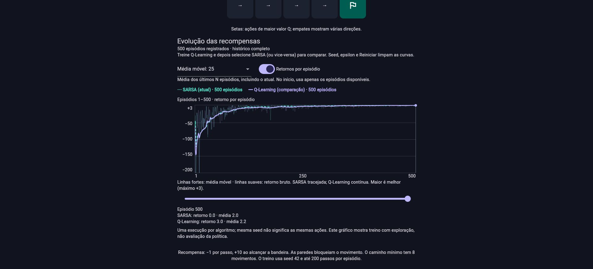
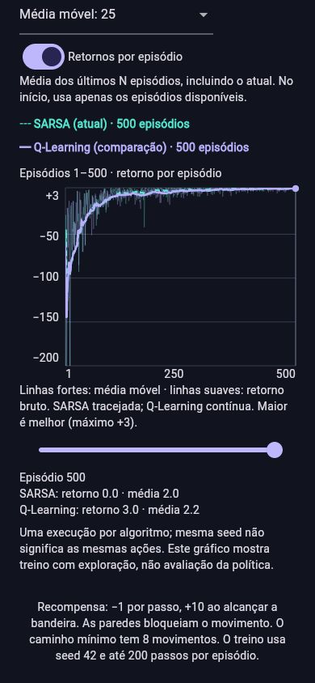

# Reinforcement Engine Lab

A responsive Flutter application over the **pure Dart** reinforcement_engine core.
The interface is in Portuguese; this guide describes the controls in English.

**[Open the live laboratory](https://kleberandrade.github.io/reinforcement-engine/)**

## Run and reproduce

Validated with **Flutter 3.50.0 / Dart 3.14.0**. CI pins Flutter 3.50.0 and the
application lockfile; the library still supports Dart 3.3+ with its own resolution.
From this directory:

```sh
flutter pub get
flutter run -d chrome
flutter analyze --fatal-infos
flutter test
flutter build web --no-web-resources-cdn --base-href /reinforcement-engine/
```

The GitHub Actions workflow publishes the static build only after both Dart jobs
and Flutter tests pass. The repository path is part of `base-href`; use `/` when
serving at a domain root. Web render resources are bundled with the build.

## Guided scenarios

1. **Learn the route.** Keep Q-Learning, seed 42 and initial epsilon 1. Press
   **Treinar +500**, then **Avaliar ×50**. The validated default run reaches 100%
   success in eight moves. **Executar** animates the greedy route without learning.
2. **Compare algorithms.** Choose SARSA, Expected SARSA, Double Q-Learning,
   SARSA(λ) or Watkins Q(λ), then train and evaluate. Changing algorithm resets
   training, counters and rewards. All six pass the default eight-move scenario;
   this single deterministic maze is not a ranking of algorithms.
3. **Study exploration.** Change initial epsilon or choose seed 7/123. These
   controls reset the agent. Current epsilon decays by .995 after each training
   episode, with floor .01. Alpha is .2, gamma .99, and trace lambda .8.
   Low exploration can produce poor routes; train more or reset the experiment.
4. **Inspect learning.** Each open cell shows all actions tied for maximum Q.
   Unseen values are zero, so several arrows can appear. Playback breaks greedy
   ties randomly. The robot hides its cell's arrow visually; its accessible label
   retains the policy. The reward chart shows every episode from episode 1,
   with a trailing moving average. See the comparison workflow below.
5. **Control execution.** **Pausar** preserves the current training batch or
   playback position. **Continuar** resumes it. **Cancelar** stops scheduling while
   preserving learned values and recorded rewards. **Reiniciar** cancels active
   work and creates a new seeded agent with the selected settings.

## Compare Q-Learning and SARSA

1. Keep seed 42 and initial epsilon 1. Train Q-Learning for 500 episodes.
2. Switch to SARSA and train 500 episodes. The chart preserves Q-Learning's
   latest run as an immutable reference. Both share the same episode axis and
   fixed return scale **−200 to +3**. A shorter run ends at its last observation;
   it is not padded, extrapolated or stretched across the longer run.
3. Compare the violet solid Q-Learning curve with the green dashed SARSA curve.
   Strong lines show trailing means; faint lines show raw per-episode returns.
   Turn off **Retornos por episódio** to focus on the smoothed curves.
4. Choose **Média móvel: 10/25/50/100** (default 25). At episode t, the mean uses
   episodes max(1, t−N+1) through t. Initial windows use fewer observations,
   without zero padding or future values. Every episode is retained and plotted.
5. Use the episode slider (keyboard or touch) to read both algorithms' exact
   raw return and moving mean. A missing episode is identified explicitly.

Switching algorithms restarts the active learner while retaining the latest
Q-Learning/SARSA curves for these settings. Changing seed/initial epsilon or
pressing **Reiniciar** clears both active and reference histories. Train the same
number of episodes for an easier visual comparison. Other algorithms still show
full-history curves but do not overlay the Q-Learning/SARSA reference.

This is one training run per algorithm, not a statistical benchmark. The same
seed does not mean the same actions because the algorithms consume random draws
differently. Training returns include exploration; use **Avaliar ×50** separately
to measure a fixed greedy policy. The chart does not change values, RNG or epsilon.





Reward is −1 per nonterminal step and +10 upon reaching the flag. The shortest
route has eight moves and return **+3**, not +10. Collisions cost a step. Training
caps each episode at 200 steps; playback and evaluation cap at 100. A cap is not
success. Ten episodes run per timer tick, leaving Flutter opportunities to render;
this is bounded main-thread work, not an isolate or background worker.

## Training versus observation

Training owns its environment and RNG (selected seed). Evaluation creates 50 fresh
environments with a separate RNG, seed 7. Playback also owns a fresh environment
and RNG, seed 7. Neither observation mode updates values, decays epsilon or consumes
the training RNG. A regression test compares all 1,000 training returns with and
without evaluation/playback inserted between two batches.

Reproducibility means the same runtime, seed, settings and training call order.
It does not promise identical Random streams across Dart versions/platforms.
Evaluation on this deterministic maze does not demonstrate generalization,
robustness or performance on stochastic tasks. Additional seeds/settings are
exploratory; the documented success result applies to the default scenario.

## Other laboratories

- **Tarefa contínua:** R-learning over the maintenance task. Trains 100-step
  blocks per timer tick and preserves state/rho across blocks. Evaluation uses a
  fresh environment. Reset stops work; leaving the page disposes its timer.
- **Salvar e retomar:** train +100, export JSON, create a new agent, import and
  train again. Import creates a new random stream; it does not replay the old RNG.
  Invalid JSON is rejected. [Checkpoint contract](../../doc/checkpoints.md).
- **Bandits:** UCB1 or fixed epsilon-greedy on synthetic .2/.5/.8 reward chances.
  Bars show lifetime selection shares, not probabilities that an arm is best.
  Policy changes reset the experiment; leaving cancels its timer.

Maze pause/resume controls belong to the maze. Other pages have their own reset
and lifecycle controls. There is no arbitrary map editor, persistent browser
storage, neural network, continuous control, server training or worker execution.
For substantially larger tasks, supply an outer isolate adapter rather than
increasing synchronous batch size. The core has no Flutter, IO or network imports.

## Accessibility and verified scope

Native Material controls support keyboard focus and activation. Grid cells expose
role/state/policy labels, status is a live region and chart summaries have text.
Symbols identify walls, robot and goal in addition to color. Content scrolls on
narrow displays. Widget tests cover 360×800 with 200% text, labeled targets,
Android target sizes, cancellation/reset, observation independence and all six
algorithms. Browser captures and hosted validation are recorded in
[the validation report](../../doc/lab_validation.md). These checks are not a
comprehensive assistive-technology audit or a claim of WCAG certification.

## Português

Treine, avalie e execute separadamente. Mudar algoritmo, seed ou epsilon inicial
reinicia o aprendizado. **Pausar/Continuar** preserva a execução atual;
**Cancelar** preserva os valores aprendidos; **Reiniciar** zera o experimento.
Setas mostram empates da política gulosa. O gráfico mantém todos os episódios,
com média móvel de 10, 25, 50 ou 100 episódios. Treine Q-Learning, troque para
SARSA e treine novamente: a curva anterior fica sobreposta na mesma escala.
Use o seletor de episódio para consultar retornos e médias; mudar seed/epsilon
ou Reiniciar limpa ambas as curvas.
Avaliar e executar usam ambiente e RNG próprios, sem alterar o treino seguinte.
A rota mínima tem oito movimentos e retorno +3. Seeds diferentes e pouca
exploração podem exigir mais treino. Não há editor de mapas ou treino no servidor.
